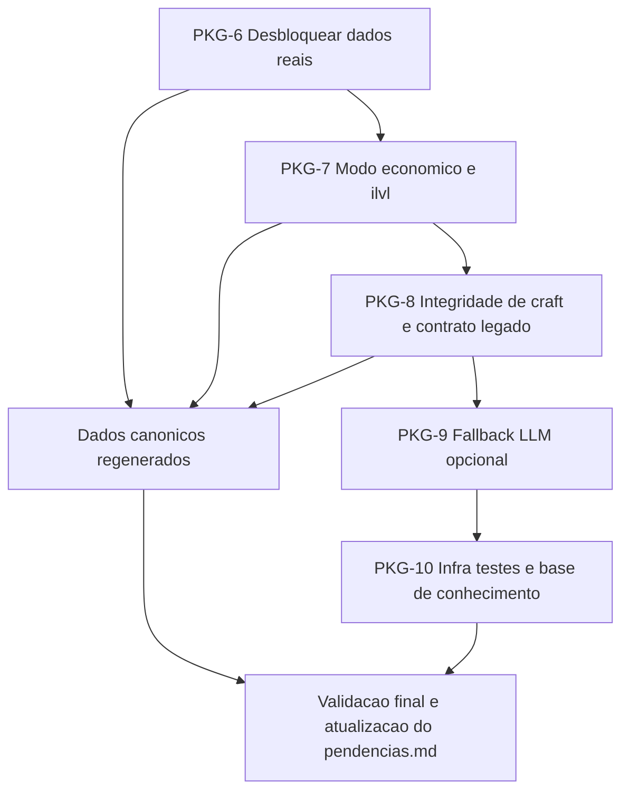
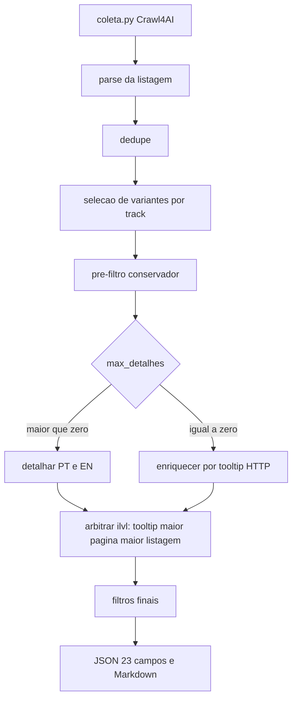

# Próximo Ciclo — Continuação das Correções

> Plano criado em **2026-11-06** a partir de [`pendencias.md`](pendencias.md:1).
> Escopo: fechar as pendências `P-01` … `P-12` em pacotes executáveis, cada um com
> arquivos-alvo, testes e critério de aceite objetivo.

---

## 1. Estado verificado no código (auditoria de 2026-11-06)

| ID | Status no documento | Verificação feita no código | Conclusão |
|---|---|---|---|
| P-01 (F-01) | `[x]` código pronto, falta rede | [`config.py:230`](config.py:230) `TRACKS_SEASON2`; [`scraper_season2.py:718`](scraper_season2.py:718) `_selecionar_melhores_variantes`; métricas em [`scraper_season2.py:1269`](scraper_season2.py:1269); 7 casos em [`tests/test_selecao_variantes.py`](tests/test_selecao_variantes.py:1) | **Implementado**, mas há **gap residual na UI** (ver P-01b) |
| P-01b (novo) | não listado | [`config.py:297`](config.py:297) `urls_template` de `gear_season2` usa `min-ilvl/max-ilvl` **sem** `bonus`/`quality`; [`config.py:241`](config.py:241) `SEASON2_ITEM_URLS` **tem** `bonus=12846:...&quality=4`; o app usa [`resolver_urls_categoria()`](config.py:441) via [`app_streamlit.py:802`](app_streamlit.py:802) | **Duas verdades para a listagem**: a CLI usa a URL boa, a UI usa a pobre |
| P-02 | `[ ]` | [`data/wowhead_itens_season2.json`](data/wowhead_itens_season2.json:9) `total_itens = 1`, `descartes.ilvl_fora = 19` | Dado canônico precisa ser regenerado |
| P-03 (F-05) | `[ ]` | [`scraper_season2.py:927`](scraper_season2.py:927) retorna cedo sem detalhes; descarte `sem_ilvl` em [`scraper_season2.py:1093`](scraper_season2.py:1093); o teste [`test_listagem_50_sem_detalhes_retorna_mais_de_40`](tests/test_max_detalhes.py:151) **monkeypatcha `_finalizar`** na linha 166 | Teste não cobre o modo real → F-05 aberto |
| P-04 | `[ ]` | [`tooltip_client.py:146`](tooltip_client.py:146) retorna só `nome`, `item_level`, `track_rotulo`, `qualidade` | Não serve para enriquecer nome PT/EN, ícone e atributos |
| P-05 (F-02) | `[ ]` | [`tools/validar_craft.py:90`](tools/validar_craft.py:90) monta URLs `item=<id>` sem `bonus` e não usa `_arbitrar_ilvl` | Validador e pipeline divergem de contexto |
| P-06 (F-08) | `[ ]` | [`scraper_sem_llm.py:49`](scraper_sem_llm.py:49), [`:64`](scraper_sem_llm.py:64), [`:79`](scraper_sem_llm.py:79) sem `icone`, `nome_en`, atributos e tooltip | Contrato legado incompleto |
| P-07 (F-06) | `[ ]` | [`wow_season2.py:1404`](wow_season2.py:1404) `_profissao_craft_com_fonte` tem só 3 níveis: link → receita → texto; mapas carregados em [`wow_season2.py:1366`](wow_season2.py:1366) | Falta cobertura de receitas e inferência controlada |
| P-08 | `[ ]` | Busca textual não encontra `_extrair_com_llm` | Fallback LLM inexistente |
| P-09 (F-03) | `[ ]` | [`requirements-dev.txt:12`](requirements-dev.txt:12) declara `pytest>=8,<9`; não existe `conftest.py` na raiz | Ambiente sem dev-deps |
| P-10 (F-07) | `[ ]` | JSON canônico com 1 item | Base pequena |
| P-11 (F-12) | `[ ]` | [`base_conhecimento_ai_studio/pendencias.md`](base_conhecimento_ai_studio/pendencias.md:1) §3.10/§3.12/§3.13 abertos | Itens normativos + revogação de chave (manual) |
| P-12 | `[ ]` | `motivo_qualidade_craft` em [`wow_season2.py:2028`](wow_season2.py:2028) | Auditar após P-02/P-07 |

---

## 2. Estratégia em pacotes



### PKG-6 — Desbloquear dados reais (P-01b, P-02, P-10)

**Objetivo:** uma única fonte de verdade para a listagem de gear e dados canônicos
com volume suficiente para validar UI e filtros.

1. **P-01b — unificar a URL de gear.**
   - Criar em [`config.py`](config.py:222) uma constante única, ex.:
     `GEAR_QUERY_SEASON2 = "bonus=12846:12854:12856:13440&quality=4"`.
   - `SEASON2_ITEM_URLS` passa a ser montada a partir dela.
   - `CATEGORIAS_WOW["gear_season2"]["urls_template"]` passa a incluir os mesmos
     parâmetros em `armor` e `weapons`, mantendo `{min}`/`{max}`.
   - Manter `url_filtro` como está: [`_aplicar_url_filtro()`](config.py:413) é
     idempotente por chave e não duplicará `min-ilvl`/`max-ilvl`.
   - Teste novo offline: `resolver_urls_categoria("gear_season2")` retorna URLs
     contendo `bonus=12846:12854:12856:13440` e `quality=4`, sem `min-level`.
2. **P-01 (revalidação online) —** `python scraper_season2.py --max-itens 20 --max-detalhes 20`
   → ≥ 15 itens com `item_level` 305–350, `nome_ptbr` e `icone_url` não vazios.
   Registrar as métricas `variantes_antes_selecao`, `variantes_depois_selecao`,
   `itens_distintos`, `selecao_variante` no `pendencias.md`.
3. **P-02 — regenerar canônicos.**
   - `python scraper_season2.py --max-itens 30 --max-detalhes 30 --qualidade-craft 5`
   - Aceite: JSON com ≥ 20 itens, `nome_en`, `nome_ptbr`, `icone_url`,
     `tooltip_raidbots`, `tooltip_raidbots_en`, `nome_ptbr_fonte`, `nome_en_fonte`,
     `icone_fonte`, `atributos_fonte`, `atributos_primarios` preenchidos em 100% dos
     itens; Markdown com 23 colunas e seção de tooltips.
4. **P-10 — ampliar base.**
   - `python scraper_season2.py --max-itens 200 --max-detalhes 50`
   - Aceite: ≥ 100 itens de gear e ≥ 30 de catálogo.

**Riscos:** `quality=4` exclui lendários; se algum item da temporada for lendário,
avaliar remover `quality` da query e confiar no filtro local `qualidade_min`.

---

### PKG-7 — Modo econômico e consistência de ilvl (P-04, P-03, P-05)

**Objetivo:** tornar `--sem-detalhes` útil e alinhar validador ao pipeline.

1. **P-04 — `tooltip_client` completo.**
   - Ampliar [`_interpretar_resposta()`](tooltip_client.py:103) e o contrato de
     [`consultar_tooltip()`](tooltip_client.py:282) para retornar:
     `nome`, `item_level`, `track_rotulo`, `qualidade`, `nome_ptbr`, `nome_en`,
     `icone_url`, `atributos_primarios`, `atributos_secundarios`, `bonus_ids`,
     `tooltip_html`.
   - Reutilizar [`extrair_atributos()`](wow_season2.py:445) sobre o texto do tooltip
     (sem duplicar regex).
   - Ícone: ler `icon`/`iconUrl` do JSON quando existir; se ausente, retornar `""`
     (não inventar). Manter cache/TTL e a regra de **nunca levantar exceção**.
   - `locale` continua sendo a chave de cache (`8` = PT-BR, `0` = EN).
   - Teste offline novo: fixture JSON/HTML cobrindo os 10 campos e o cache por locale.
2. **P-03 — enriquecimento por tooltip no modo sem detalhes.**
   - Novo método em [`scraper_season2.py`](scraper_season2.py:917):
     `async def enriquecer_por_tooltip(self, itens)`.
   - Chamado em [`executar_por_categorias()`](scraper_season2.py:1248) quando
     `self.max_detalhes == 0` ou `self.buscar_detalhes is False`, **depois** de
     seleção/pré-filtro e **antes** de `_finalizar`.
   - Preencher com `setdefault`: `nome_ptbr`, `nome_en`, `item_level`, `icone_url`,
     `atributos_primarios`, `atributos_secundarios`, `qualidade`.
   - Fontes: `nome_ptbr_fonte="tooltip_http"`, `nome_en_fonte="tooltip_http"`,
     `atributos_fonte="tooltip_http"`, `icone_fonte="tooltip_http"`.
   - **Ajuste de escala necessário:** [`FONTES_ICONE`](wow_season2.py:931) hoje é
     `("pagina", "og_image", "cdn_inferido", "llm", "ausente")` — incluir
     `"tooltip_http"`, senão [`_fonte_declarada()`](wow_season2.py:2098) rejeita o valor.
   - Métricas novas em `metadata`: `enriquecidos_tooltip`, `tooltip_falhas`.
   - Se o tooltip não trouxer ilvl, o item continua podendo cair em `sem_ilvl`
     (comportamento explícito em `metadata.descartes`).
   - Testes novos: (a) sem detalhes + tooltip mockado → ≥ 40 itens com nome e ilvl;
     (b) tooltip `None` → sem exceção, item contabilizado em `tooltip_falhas`.
3. **P-05 — `validar_craft` com a mesma arbitragem.**
   - Ler o JSON canônico e, para cada id, usar os `bonus_ids` registrados.
   - Passar a URL de detalhe com a variante completa e usar
     [`_arbitrar_ilvl()`](scraper_season2.py:846) como o pipeline.
   - Incluir `bonus_ids` e `ilvl_origem` no relatório
     [`data/_diagnostico/craft.json`](data/_diagnostico/craft.json:1).
   - Aceite: `python tools/validar_craft.py --ids 237831 237839` reporta o mesmo
     `item_level` e `bonus_ids` do JSON canônico.

**Dependência:** P-03 depende de P-04; ambos dependem de P-02 apenas para medição em escala.

---

### PKG-8 — Integridade de craft e contrato legado (P-07, P-06, P-12)

1. **P-07 — profissão de craft em escala.**
   - Ampliar [`_mapa_craft()`](wow_season2.py:1366) para varrer também ids de
     receita por item e aliases de `profissao` no nível da receita.
   - Adicionar nível 4 na hierarquia de
     [`_profissao_craft_com_fonte()`](wow_season2.py:1404):
     inferência por `subclass`/`slot` **somente** quando a URL/ página indicar craft,
     gravando `profissao_craft_fonte="inferido"` (baixa confiança).
   - Nunca inferir em item não craftado (`craft_indicio` sem `crafting-quality`).
   - Aceite: ≤ 5 itens em 24 sem `profissao_craft`, medido após P-02/P-10.
2. **P-06 — dataclasses legadas completas.**
   - Adicionar campos opcionais em [`scraper_sem_llm.py`](scraper_sem_llm.py:49):
     `icone: str = ""`, `nome_en: str = ""`,
     `atributos_primarios: Dict[str, int] = field(default_factory=dict)`,
     `atributos_secundarios: Dict[str, int] = field(default_factory=dict)`,
     `tooltip_raidbots: str = ""`.
   - Preencher nos adapters `dict_para_ferramenta/encantamento/missiva`.
   - Consumir na UI legada em [`app_streamlit.py:552`](app_streamlit.py:552).
   - Aceite: `asdict()` não quebra e o teste de adapter cobre os campos novos.
3. **P-12 — auditar `ignorados` de craft.**
   - Script de auditoria (pode virar `tools/diagnostico/diag_craft_ignorados.py`)
     listando `motivo_qualidade_craft` por item e confrontando com a URL de detalhe.
   - Aceite: nenhum item com `crafting-quality` e profissão detectável fica com
     `qualidade_craft=0` sem justificativa registrada.

---

### PKG-9 — Fallback LLM (P-08) — condicional à chave

1. Implementar `_extrair_com_llm()` em [`wow_season2.py`](wow_season2.py:1) com
   `montar_llm_config()` de [`config.py:65`](config.py:65), prompt PT/EN e JSON estrito.
2. Chamar **apenas** quando, após crawl + tooltip HTTP, faltar `nome_ptbr` E
   `nome_en`, ou `icone_url`, ou todos os atributos.
3. Gravar `_llm_usado` e `_llm_campos`; fontes passam a aceitar `"llm"`
   (já previsto em [`wow_season2.py:931`](wow_season2.py:931)).
4. Nunca levantar exceção; falha entra em `metadata.falhas`.
5. Aceite: teste offline com LLM mockado, sem chamada real, e
   `nome_ptbr_fonte="llm"` quando usado.
6. **Bloqueio:** exige `DEEPSEEK_API_KEY` real em [`.env`](.env:1) (ação do usuário).

---

### PKG-10 — Infra, testes e base de conhecimento (P-09, P-11)

1. **P-09 — habilitar pytest.**
   - `pip install -r requirements-dev.txt`.
   - Criar `conftest.py` na raiz apenas se necessário para `sys.path` (hoje
     [`tests/__init__.py`](tests/__init__.py:1) já resolve o pacote).
   - Rodar `python -m pytest -q` e comparar com os runners de fallback
     (**104 OK / 2 SKIP** na última medição).
   - Manter os runners `python tests/<arquivo>.py`.
2. **P-11 — base de conhecimento.**
   - Resolver §3.10, §3.12 e §3.13 em
     [`base_conhecimento_ai_studio/pendencias.md`](base_conhecimento_ai_studio/pendencias.md:135)
     com evidência por seção.
   - Registrar a **revogação da chave Firecrawl** em
     [`docs/SEGURANCA.md`](docs/SEGURANCA.md:1) (ação manual do usuário, prioridade máxima).
3. **Fechamento:** atualizar [`pendencias.md`](pendencias.md:1) marcando `P-0x` como
   `[x]` com comando e resultado real, e reescrever a seção de handoff.

---

## 3. Fluxo de dados alvo



---

## 4. Matriz de validação

| Pacote | Testes offline a criar/rodar | Validação online |
|---|---|---|
| PKG-6 | `test_resolver_urls_gear_com_bonus`, suíte completa | `--max-itens 20 --max-detalhes 20`; depois `--max-itens 30 --max-detalhes 30` |
| PKG-7 | `test_tooltip_campos_completos`, `test_sem_detalhes_enriquece_tooltip`, `test_validar_craft_mesmo_ilvl` | `--sem-detalhes --max-itens 200`; `tools/validar_craft.py --ids 237831 237839` |
| PKG-8 | `test_profissao_inferida_so_com_craft`, `test_dataclasses_campos_novos` | auditoria de `motivo_qualidade_craft` |
| PKG-9 | `test_llm_fallback_mockado` | requer `DEEPSEEK_API_KEY` |
| PKG-10 | `python -m pytest -q` | — |

**Regra de ouro:** após qualquer mudança em [`wow_season2.py`](wow_season2.py:1) ou
[`scraper_season2.py`](scraper_season2.py:1), rodar os **17 arquivos** de teste
(16 em `tests/` + `test_season2.py`).

---

## 5. Ordem de execução

`PKG-6 (P-01b → P-01 → P-02) → PKG-7 (P-04 → P-03 → P-05) → PKG-8 (P-07 → P-06 → P-12)
→ PKG-9 (P-08) → PKG-10 (P-09 → P-11) → P-10 (volume) → fechamento do pendencias.md`

---

## 6. Decisões abertas

1. **Rodadas de rede neste ciclo:** executar as validações online junto com o código
   ou limitar o ciclo a código + testes offline e deixar a coleta para um pacote final?
2. **`quality=4` na listagem de gear:** manter (restritivo, evita itens antigos) ou
   remover e confiar só no filtro local de raridade?
3. **P-08 (LLM) neste ciclo:** depende de `DEEPSEEK_API_KEY` real; incluir agora ou deixar
   para o ciclo seguinte?
4. **`.vscode/mcp.json`:** versionar ou manter gerado por `python mcp_server.py --print-config`?

---

## 7. Estado de execução (2026-11-06)

### Concluído neste ciclo

| Pacote | Item | Resultado |
|---|---|---|
| PKG-6 | P-01b | Listagem unificada **descartada como fonte** após medição; criada lista canônica de **118 IDs** (`data/season2_gear_ids.json`) com `bonus=12856` |
| PKG-6 | P-01 | **20/20** itens com `item_level = 341`; 0 descartes por `ilvl_fora`; `ilvl_origem = {"pagina": 20}` |
| PKG-6 | P-02 | JSON regenerado com 20 itens e **100%** dos 8 campos; Markdown com `Craft (R)` e tooltips |
| PKG-7 | P-04 | `tooltip_client` com 12 campos; cache antigo invalidado |
| PKG-7 | P-03 | `enriquecer_por_tooltip()` + métricas; teste offline com ≥40 itens |
| PKG-7 | P-05 | `validar_craft` usa `bonus_ids` do canônico |
| PKG-8 | P-07 | Mapa receita→profissão corrigido para IDs usados como chave; `237831`/`237839` → Ferraria |
| PKG-8 | P-06 | Dataclasses legadas com ícone, nome EN, atributos e tooltip |
| PKG-8 | P-12 | `tools/diagnostico/diag_craft_ignorados.py` criado |

Testes novos: [`tests/test_config_urls_gear.py`](tests/test_config_urls_gear.py:1),
[`tests/test_tooltip_client_campos.py`](tests/test_tooltip_client_campos.py:1),
[`tests/test_enriquecimento_tooltip.py`](tests/test_enriquecimento_tooltip.py:1),
[`tests/test_validar_craft_bonus.py`](tests/test_validar_craft_bonus.py:1),
[`tests/test_sem_llm_campos_novos.py`](tests/test_sem_llm_campos_novos.py:1),
[`tests/test_mapa_craft_ids.py`](tests/test_mapa_craft_ids.py:1).

### Lição aprendida sobre a listagem do Wowhead

A URL `?bonus=...&quality=4&min-ilvl=...` **não** filtra no servidor. O diagnóstico
mostrou 192 linhas de 50 ids antigos, todas com `item_level=0`, e os `bonus_ids` eram
opções do menu de filtros. Por isso a fonte de gear precisa ser uma **lista de IDs**,
não uma listagem genérica.

### Próximos passos (ordem)

`P-10 (rodada de 200 em terminal externo) → P-09 (pytest) → P-08 (LLM, se houver chave)
→ P-11 (base de conhecimento)`. O novo risco do `crafting-quality` em gear não craftado
está registrado em [`pendencias.md`](pendencias.md:1), seção "Ciclo PKG-6 … PKG-8".

---

## 8. P-13 — Somente itens R5 e raridade Épica

**Requisito definido pelo usuário:** entregar apenas itens **craftados R5** e com
raridade **Épico (4)**.

### Implementação

| Item | Resultado |
|---|---|
| Raridade padrão de gear | `QUALIDADE_MINIMA_GEAR_PADRAO = 4` em [`config.py:222`](config.py:222); o fluxo legado de catálogo continua em 3 |
| Filtro estrito | `exigir_craft=True` descarta `qualidade_craft != qualidade_craft_min`, inclusive `0`, em [`scraper_season2.py:1254`](scraper_season2.py:1254) |
| Contador | `descartes["sem_craft"]` separado de `qualidade_craft` |
| Fonte de dados | `data/season2_craft_ids.json` com **112 IDs** gerados por [`tools/gerar_ids_craft_s2.py`](tools/gerar_ids_craft_s2.py:1) |
| Seleção de URLs | [`urls_craft_canonicas()`](config.py:319) e `resolver_urls_categoria(..., somente_craft=True)` |
| CLI | `--exigir-craft/--no-exigir-craft` (padrão ligado) e `--qualidade-min` padrão 4 |
| UI | checkbox “Somente itens craftados no rank acima”, ligado por padrão |
| MCP | parâmetro `exigir_craft` (padrão `False` para consulta avulsa) |
| Testes | [`tests/test_exigir_craft.py`](tests/test_exigir_craft.py:1) **8 OK**, [`tests/test_config_urls_craft.py`](tests/test_config_urls_craft.py:1) **6 OK** |

### Consequência nos dados

Os 20 itens regenerados anteriormente são **drops de M+ não craftados**
(`qualidade_craft=0`). Com `--exigir-craft` ligado, a rodada passa a usar os 112
IDs de craft; os itens que não expuserem `crafting-quality=5` na página são
descartados em `sem_craft`.

### Pendência de validação

Rodar em terminal externo (evita a sensação de “comando travado”):

```bat
set PYTHONIOENCODING=utf-8
python scraper_season2.py --max-itens 30 --max-detalhes 30 --qualidade-craft 5
```

Aceite: todos os itens com `qualidade = 4` e `qualidade_craft = 5`, e
`metadata.filtros.exigir_craft = true`.

---

## 9. P-08 — Fallback LLM (implementado)

- `faltando_campos_llm()`, `_extrair_com_llm()` e `aplicar_llm_em_item()` em
  [`wow_season2.py:2198`](wow_season2.py:2198).
- `completar(prompt, texto)` é injetável; a chamada real usa
  `crawl4ai.perform_completion` + `config.montar_llm_config()`.
- Nunca levanta exceção; falha vai para `_llm_erro`. Fontes `"llm"` são gravadas apenas
  nos campos que estavam vazios.
- Testes: [`tests/test_llm_fallback.py`](tests/test_llm_fallback.py:1) — **8 OK**, sem rede.

## 10. Estado final da suíte

| Execução | Resultado |
|---|---|
| `python -m pytest -q tests --ignore=tests/test_app_streamlit.py` | **148 passed, 2 skipped** em ~48s |
| `python -m pytest -q tests/test_app_streamlit.py` | **4 passed** |
| `python test_season2.py` | **12 grupos OK** |
| `python tools/validar_craft.py --ids 237831 --sem-ingles` | **1/1 ok** (R5, Épico, Ferraria, ilvl 341) |

### Pendências que continuam abertas

1. Varredura de volume de 200 itens (P-10), em terminal externo com log em arquivo.
2. §3.10/§3.12/§3.13 da base de conhecimento (validação normativa contra o jogo).
3. Revogação manual da chave Firecrawl.
